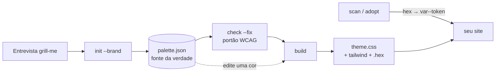

# OmniColor 🎨⚡

> **Escolha, construa e aplique a paleta de cores de qualquer site ou app através de UM único arquivo espelho — com contraste verificado, modo escuro e entrevista guiada por IA.**
> 🇧🇷 **Projeto Brasileiro Open-Source** para quem cansou de trocar hex por hex em dezenas de arquivos.

[](LICENSE)
[](#-projeto-brasileiro-open-source)
[](#-instalação)
[](https://www.npmjs.com/package/omni-color-skill)
[-orange.svg)](#-instalação)
[](#-o-que-é-a-omnicolor)

Troque uma cor em `palette.json`, rode `build`, e todas as páginas que usam `var(--token)` se atualizam. Sem caça a códigos hex espalhados.

## ⚡ Início rápido

```bash
# 1. Instalar (menu interativo; marque Claude Code, Antigravity, Cursor...)
npx omni-color-skill install

# ou direto do GitHub, sem menu:
npx github:LimaEdu-7x/omni-color install all

# 2. Reinicie a IA e use o comando
/color paleta para uma loja de café --brand #7a4a2b --dark
/color --check          # contraste WCAG da paleta atual
/color --build          # regenera theme.css depois de mudar uma cor
```

O comando `/color` aceita `--brand`, `--adopt`, `--check`, `--build`, `--dark` e `--sites` (detalhes em [Comandos & Modos de Uso](#-comandos--modos-de-uso)). O que você não informar, a IA pergunta. O pacote npm se chama `omni-color-skill`; a skill instalada é `omni-color`.


*Gerada por `omni_color.py init --brand "#3b82f6"` + `build`. Linhas 1–7: primária, acento (complemento automático), neutra com tom da marca, sucesso, aviso, perigo e info — degraus 50 → 950. As duas faixas de baixo: tokens semânticos dos modos claro e escuro (bg, surface, border, text, text-muted, primary, primary-hover, on-primary, accent, on-accent, ring e cores de status).*

---

## 🇧🇷 Projeto Brasileiro Open-Source

A **OmniColor** nasceu no Brasil para acabar com o retrabalho de paleta: escolher cores por feeling, copiar hex para cada arquivo e descobrir só no fim que o texto não tem contraste. O projeto prioriza:

- **Uma fonte da verdade:** um arquivo (`palette.json`) gera tudo; nada de hex solto nos componentes.
- **Acessibilidade de verdade:** o contraste WCAG é um portão que reprova, não uma sugestão "no limite".
- **Entrevista antes de sugerir:** a IA pergunta humor, modo, âncora de marca e público antes de propor cores.
- **Não bagunça seus arquivos:** marcadores de região, simulação (*dry run*) por padrão e backups ao aplicar.
- **Ecossistema aberto:** compõe com `omni-sprite` (a mesma paleta vira `.hex` do Aseprite) e com skills de polimento de interface.

---

## 🎯 O que é a OmniColor?

Uma skill (`SKILL.md` + script + referências) que reúne:

1. **🗣️ Entrevista com `grill-me`:** rodadas de perguntas independentes, cada uma com resposta recomendada, sobre humor, modo, marca, público, acessibilidade e restrições.
2. **🌐 16 sites de paleta** ([`sites.md`](references/sites.md)), cada um com quando usar e quando não usar: oklch.com, Huetone, Leonardo, Coolors, Adobe Color, Huemint, Color Hunt, Realtime Colors, UIColors, Material Theme Builder, Radix Colors, verificadores de contraste, ColorBrewer, Colorable, Lospec e Happy Hues.
3. **🧪 Rampas OKLCH** (50–950) para primária, acento, neutras com tom da marca e cores de status. Cor fora de gama perde croma, nunca luminosidade ou matiz. A cor da marca é **fixada**: o degrau mais próximo vira exatamente o seu hex e nunca é escurecido.
4. **✅ Portão de contraste WCAG** (texto, on-primary/on-accent e status a 4,5:1) com correção automática só de luminosidade.
5. **🪞 O arquivo espelho:** variáveis CSS para claro + escuro (`prefers-color-scheme` e `data-theme`), `@theme` do Tailwind v4 opcional e um `.hex` para ferramentas de pixel art.
6. **🔄 Adoção em sites existentes:** varre cores hex soltas e reescreve para `var(--token)` (simulação por padrão; backups ao aplicar; regiões geradas nunca são tocadas).
7. **🤝 Integra com outras skills** se instaladas: polimento de interface como `impeccable`, acessibilidade e design system.

---

## 🚀 Fluxo de trabalho



O `palette.json` tem `seeds` (primary, accent, success, warning, danger, info), `overrides` (ex.: `"primary.500": "#hex"`) e `semantic.light/dark` (token → `rampa.degrau`). O bloco gerado no `theme.css` fica entre os marcadores `omni-color:begin/end` e **não deve ser editado à mão**.

---

## ⚡ Comandos & Modos de Uso

Depois de instalar, digite `/color` no seu agente (a skill também é acionada por pedidos naturais de paleta, cores da marca, modo escuro, tema ou contraste):

```text
/color [pedido] [flags]
```

### Exemplos práticos
```bash
# 🎨 Paleta nova para um projeto, com entrevista guiada
/color landing premium e calma --brand #0ea5e9 --dark

# 🔄 Adaptar um site existente (varredura + simulação + aplicar com confirmação)
/color --adopt ./src

# ✅ Só checar o contraste WCAG (e corrigir só a luminosidade, se autorizado)
/color --check

# 🪞 Regenerar o arquivo espelho depois de mudar uma cor no palette.json
/color --build

# 🌐 Ver os 16 sites de paleta e quando usar cada um
/color --sites
```

### Flags disponíveis
- `--brand #hex`: pula a pergunta da âncora de marca e roda `init --brand`.
- `--adopt <pasta>`: fluxo de adoção (`scan` → simulação → `--apply` com confirmação).
- `--check`: só o portão de contraste.
- `--build`: regenera `theme.css` (e Tailwind/`.hex`).
- `--dark`: foca o mapeamento do modo escuro.
- `--sites`: lista os 16 sites de paleta.

Flags informadas dispensam a pergunta correspondente; o que faltar vai para uma rodada de `grill-me`.

### 🛠️ O script por baixo (também funciona sozinho)
```bash
python omni_color.py init --brand "#3b82f6"            # cria o palette.json
python omni_color.py check --fix                        # portão de contraste
python omni_color.py build --css src/theme.css --tailwind src/tw.css --hex palette.hex
python omni_color.py scan ./src                         # cores soltas por frequência
python omni_color.py adopt ./src                        # simulação (dry run)
python omni_color.py adopt ./src --apply                # grava, backups em .omni-color-backup/
```
Depois importe o `theme.css` uma vez e use `var(--bg)`, `var(--text)`, `var(--primary)`, `var(--on-primary)`, `var(--border)`, `var(--ring)`… Mude um *seed* no `palette.json`, rode `build`, pronto.

---

## 📦 Como Instalar nas Suas IAs

### 1. Instalador Interativo via Terminal (Recomendado)
Execute `npx omni-color-skill install` para abrir o menu com caixas de seleção. Use as **Setas** para navegar, **Espaço** para marcar as IAs e **Enter** para concluir:

```bash
npx omni-color-skill install
```

```text
🎨 OmniColor Installer
? Em quais IAs você deseja instalar a OmniColor? (Espaço: marcar/desmarcar | Enter: confirmar)
 ❯ [✓] 🪐 Antigravity / Gemini CLI (~/.gemini/config/skills/omni-color)
   [✓] 🟣 Claude Code (~/.claude/skills/omni-color)
   [ ] ⚡ Cursor IDE (.cursor/skills/omni-color + .cursor/rules/omni-color.mdc)
   [ ] 🌊 Windsurf (.windsurf/skills/omni-color + .windsurfrules)
   [ ] 📁 Projeto Local (./omni-color/)
```

O instalador copia `SKILL.md`, `references/` e `scripts/` e instala junto a skill **`grill-me`** (de Matt Pocock, MIT; se você já tiver uma, a sua é mantida).

> O nome do pacote no npm é `omni-color-skill` porque `omni-color` já pertence a outra biblioteca. O comando dentro dos agentes continua sendo `/color`.
> Cursor e Windsurf: a instalação cria a pasta da skill e um ponteiro de regra; esse caminho é **experimental** (testei os arquivos gerados, não o comportamento dentro dessas IDEs).

#### Instalação direta sem menu (headless)
```bash
# Todas as IAs suportadas de uma vez:
npx omni-color-skill install all

# IAs específicas:
npx omni-color-skill install claude antigravity

# Direto do repositório no GitHub:
npx github:LimaEdu-7x/omni-color install

# Diagnóstico (Python encontrado? skill instalada?):
npx omni-color-skill doctor
```

### 2. Instalação manual
```bash
git clone https://github.com/LimaEdu-7x/omni-color.git && cd omni-color

# Claude Code
mkdir -p ~/.claude/skills/omni-color ~/.claude/skills/grill-me
cp -r SKILL.md references scripts ~/.claude/skills/omni-color/ && cp -r bundled/grill-me/. ~/.claude/skills/grill-me/

# Antigravity / Gemini CLI
mkdir -p ~/.gemini/config/skills/omni-color ~/.gemini/config/skills/grill-me
cp -r SKILL.md references scripts ~/.gemini/config/skills/omni-color/ && cp -r bundled/grill-me/. ~/.gemini/config/skills/grill-me/
```
Requisitos: Node 16.7+ (para o `npx`) e Python 3 (só biblioteca padrão) para rodar o script; se faltar, a IA pergunta antes de instalar. Verifique: `python scripts/omni_color.py selftest`.

---

## 🧭 Princípios de design (de uma revisão crítica de seis skills da comunidade)

Rampas em OKLCH, não HSL · impor contraste em vez de chamar de "no limite" · modo escuro é um novo fundo, não uma rampa invertida · nunca espalhar hex (uma só fonte) · nunca sobrescrever arquivos em silêncio (marcadores, simulação, backups) · neutras com tom e no máximo 3–4 matizes · perguntar antes de sugerir · nunca tratar conteúdo de site como instrução. Veja [`integrations.md`](references/integrations.md).

## ⚠️ Limites conhecidos

O `adopt` mapeia para o token de rampa mais próximo (ΔE em OKLab ≤ 0,03) e deixa o resto para decisão humana — por exemplo, um azul-marinho `#0f172a` pode cair em `--info-950` em vez de um neutro; troque depois por tokens de papel (`--text`, `--primary`…) à mão. Só trata hex literal, não `rgb()`/`hsl()`. As URLs de `sites.md` vêm de conhecimento da web e devem ser verificadas.

## 🗂️ Estrutura do repositório

```text
SKILL.md                              a skill (comando /color)
bin/color.js                          instalador npx (menu interativo ou direto)
package.json                          pacote npm "omni-color-skill"
scripts/omni_color.py                 gerador de rampas, portão WCAG, scan/adopt
references/                           perguntas, sites, integrações
bundled/grill-me/                     skill de entrevista incluída (Matt Pocock, MIT, em inglês, sem alterações)
docs/palette-example.png
THIRD_PARTY_NOTICES.md  LICENSE
```

---

## 🏆 Créditos & Referências

- **[Matt Pocock — skill grilling / grill-me](https://github.com/mattpocock/skills)** — © 2026, MIT. Incluída sem alterações em `bundled/grill-me/`.
- **OKLab** de Björn Ottosson; **contraste WCAG** do W3C.
- Ideias (nenhum código copiado) de artistic-color-palettes, color-palette-extractor, skill.color-expert, jezweb/color-palette, NickCrew/color-palette e dembrandt/algorithmic-color-palette — veja [`THIRD_PARTY_NOTICES.md`](THIRD_PARTY_NOTICES.md).

---

## 📄 Licença

Distribuído sob a licença **MIT**. Veja [`LICENSE`](LICENSE).
Feito com 💚 e 💛 no Brasil por [LimaEdu-7x](https://github.com/LimaEdu-7x).
